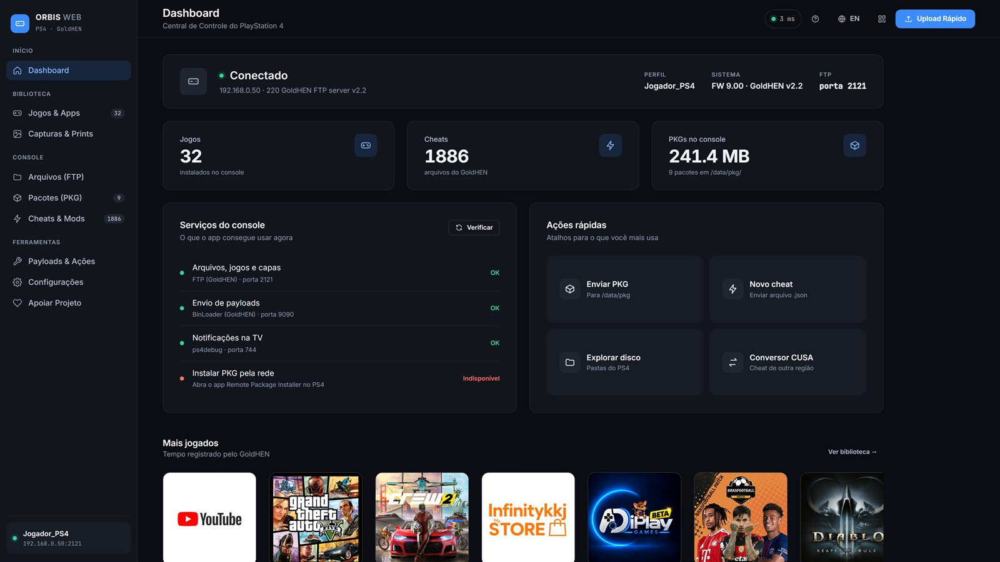
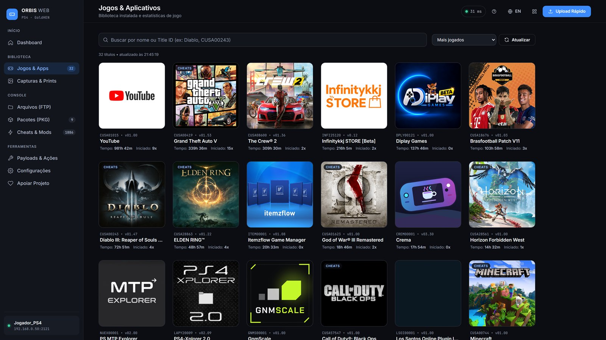
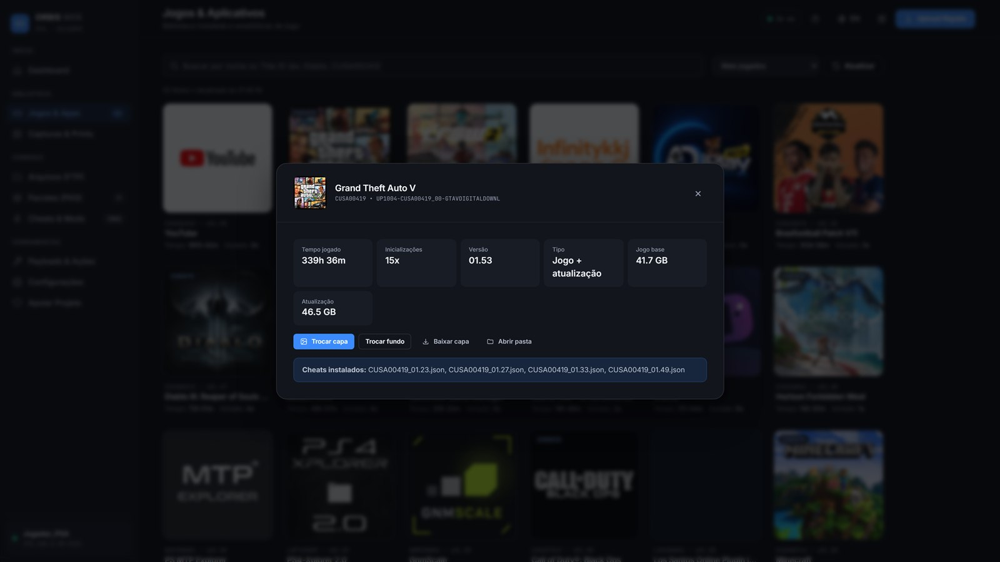
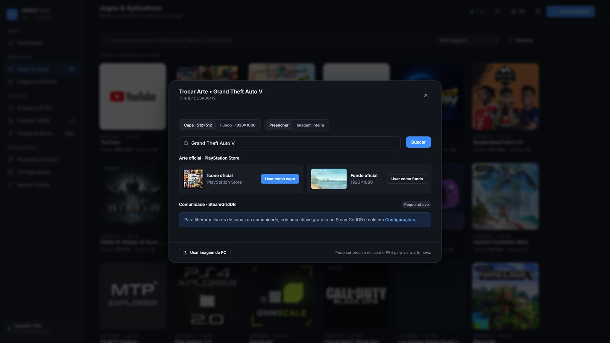
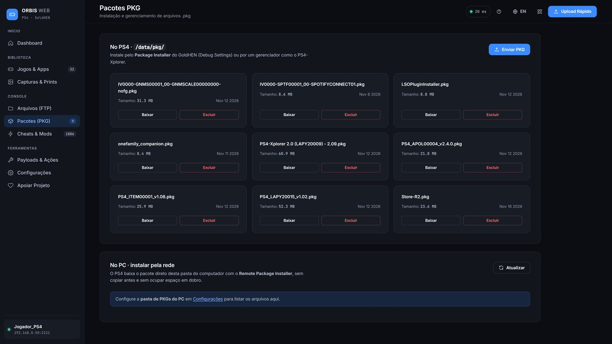
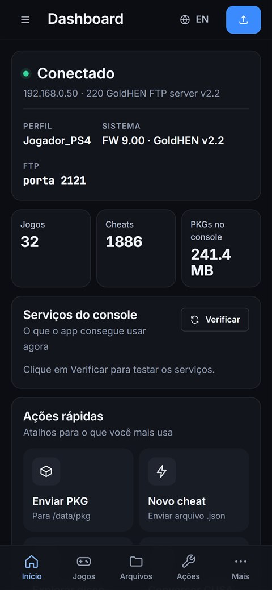

# 🎮 Orbis Web Manager (OWM)
### *A Suíte Web Definitiva para PlayStation 4 & GoldHEN*
> Inspirado no **Prospero Manager** do PlayStation 5, desenvolvido especialmente para o ecossistema do **PlayStation 4 com GoldHEN**.

---

## 🌟 O que é o Orbis Web Manager?
O **Orbis Web Manager** é uma central de comando e gerenciamento completa que roda diretamente no navegador do seu **computador, tablet ou smartphone**.

Ele se conecta diretamente ao seu **PlayStation 4** através da rede local (Wi-Fi ou cabo), permitindo controlar o console, visualizar biblioteca de jogos, tempo jogado, gerenciar arquivos, instalar pacotes PKG, adicionar e converter cheats do GoldHEN, e injetar payloads com total facilidade e sem precisar de pendrive.

## 📸 Capturas de tela



| Biblioteca de jogos | Detalhes do jogo |
|---|---|
|  |  |
| **Trocar capa (Sony / SteamGridDB)** | **Pacotes PKG** |
|  |  |

<p align="center"></p>

---

## ✨ Principais Recursos

### 1. 📊 Dashboard & Telemetria em Tempo Real
* **Status de Conexão:** Monitoramento contínuo de ping/latência e conectividade com o console.
* **Verificação de Portas:** Status das portas `2121` (FTP Server) e `9090` (BinLoader Server).
* **Perfil do Usuário:** Identificação automática do usuário ativo no console.
* **Resumo do Sistema:** Contagem de jogos instalados, cheats ativos e total de espaço ocupado por PKGs em `/data/pkg/`.

### 2. 🕹️ Biblioteca de Jogos (Game Library)
* **Capas em Alta Definição:** Ícones oficiais (`icon0.png`) carregados diretamente do disco do PS4.
* **Títulos Oficiais:** Nomes dos jogos extraídos diretamente do banco de dados oficial do console (`app.db`).
* **Estatísticas de Jogo:** Tempo total jogado (*Playtime*) e quantidade de inicializações extraídos do registro do GoldHEN.
* **Indicador de Cheats:** Selo visual destacando quais jogos possuem cheats instalados.

### 3. 📂 Explorador de Arquivos Completo (PS4 FTP Explorer)
* **Navegação em Árvore e Tabela:** Navegue por `/data/`, `/user/`, `/system/`, `/mnt/`, etc.
* **Atalhos Rápidos:** Acesso em 1 clique para pastas essenciais (`/data/pkg`, `/data/GoldHEN/cheats/json`, `/data/GoldHEN/plugins`, `/user/home`).
* **Upload por Arrastar e Soltar (Drag & Drop):** Arraste arquivos do PC ou celular direto para a janela do navegador.
* **Download e Exclusão:** Baixe arquivos do PS4 para o computador ou remova itens com segurança.
* **Criar Pastas:** Criação instantânea de diretórios.

### 4. ⚡ Cheats & Mods (GoldHEN Suite)
* **Visualizador de Cheats:** Veja todos os cheats JSON instalados com detalhes dos mods (*God Mode*, *Itens Máximos*, *Recursos Infinitos*).
* **Conversor de Região CUSA Integrado:**
  * Baixou um cheat de outra região (ex: Americana `CUSA00242`) mas seu jogo é brasileiro (`CUSA00243`)?
  * A ferramenta converte o Title ID internamente e faz o upload automático para o PS4 na pasta certa com 1 clique!

### 5. 📦 Gerenciador de PKGs
* Lista todos os pacotes `.pkg` presentes na pasta `/data/pkg/`.
* Exibe tamanho formatado (MB/GB) e data.
* Uploader dedicado de PKGs com streaming contínuo.
* Opção de excluir PKGs após instalação para liberar espaço no HD interno.

### 6. 📸 Galeria de Capturas & Mídias do PS4
* Navegue e visualize todas as capturas de tela tiradas com o botão Share.
* Filtro automático por jogo com capas em miniatura.
* Lightbox em tela cheia com botão de download em alta resolução direto para o seu computador.

### 7. 🎨 Troca de Capas e Fundos dos Jogos (Custom Covers)
* Busque artes oficiais da **PlayStation Store (Sony)** e milhares de capas da comunidade no **SteamGridDB** (chave gratuita), ou envie uma imagem do PC.
* Escolha o jogo certo no SteamGridDB, filtre por capas quadradas / grades / banners e veja a **pré-visualização exata** antes de aplicar.
* A imagem é convertida automaticamente para o formato que o PS4 usa: `icon0.png` 512×512 **e** `icon0.dds` (DXT1), que é o arquivo que a tela inicial realmente desenha. Também é possível trocar o fundo (`pic1`, 1920×1080).
* **Backup automático** da arte original no PC, com botão "Restaurar Capa Original".
* Obs.: o PS4 pode só mostrar a capa nova depois de reiniciar o console.

### 8. 🚨 Backup de Emergência do Banco de Dados (app.db)
* Baixe com 1 clique uma cópia íntegra de segurança do `app.db` (`/system_data/priv/mms/app.db`) do seu PS4 para prevenir perda de biblioteca.

### 9. 🔔 Notificações na TV (Notify OSD)
* Envie mensagens personalizadas que pipocam na tela da TV enquanto você estiver jogando no PlayStation 4.
* **Requer o payload `ps4debug` carregado** (porta `744`). Em *Payloads & Ações*, clique em **Carregar ps4debug**: o app baixa a versão oficial ([GoldHEN/ps4debug](https://github.com/GoldHEN/ps4debug/releases)), guarda uma cópia em `cache/payloads/` e envia pelo BinLoader (porta `9090`, que precisa estar aberta). Repita a cada vez que ligar o PS4.
* A porta `9090` (BinLoader) **não** serve para notificações: ela só aceita payloads executáveis. Versões anteriores deste app mandavam o texto da mensagem para a 9090, e por isso nada aparecia na TV.

### 10. ⚡ Instalador Remoto de Pacotes (RPI)
* Com o app **Remote Package Installer** (flatz) aberto no PS4 (porta `12800`), instale PKGs pela rede **direto de uma pasta do seu PC**, sem copiar para o HD antes e sem ocupar espaço em dobro. Mostra o progresso da instalação.
* Também aceita uma URL http de um `.pkg` em qualquer servidor da rede.

### 10.0 ⬇️ Monitor de Downloads do Console
* Acompanhe pelo PC ou celular o **% de download** de jogos, atualizações e DLCs da PSN (e dos pacotes enviados pelo RPI), com tamanho baixado, velocidade e tempo restante. Funciona só com o FTP: o Orbis lê a fila de transferências do próprio PS4 (`/user/bgft/task/`), sem payload extra.
* Avisa quando um download termina. Em modo de repouso o PS4 continua baixando, mas o FTP do GoldHEN não responde; a tela mostra o último progresso lido.

### 10.1 🩺 Diagnóstico de Portas
* Testa de uma vez FTP (2121), BinLoader (9090), ps4debug (744) e Remote Package Installer (12800) e mostra o que está aberto.

### 11. 📱 Acesso pelo Celular (Mobile First)
* Interface 100% responsiva com **Bottom Navigation Bar** tátil no estilo app nativo.
* **QR Code Integrado:** Basta apontar a câmera do celular para abrir o painel na hora via Wi-Fi.

### 12. 💡 Tour Interativo (Tutorial Integrado)
* Balões guiados passo a passo que ensinam o usuário desde a conexão inicial de IP do PS4 até o uso de cheats, capas e backups.

### 13. 💉 Injeção de Payloads
* Envie arquivos `.bin` diretamente para a porta `9090` do GoldHEN sem precisar de programas externos.

## 🆕 Novidades da v2.2

### 💾 Backup de saves
* Copia os saves de um jogo (ou de todos) para o PC, em `backups/saves/`, com histórico por data. Restaurar funciona no **mesmo console e mesmo usuário**; antes de restaurar, o Orbis guarda automaticamente o save atual. Também baixa qualquer backup em `.zip`.

### 🔄 Atualizações dos jogos
* Compara a versão instalada de cada jogo com a mais recente da PSN e mostra quais têm atualização (com o tamanho). Os jogos aparecem com o selo **UPDATE** na biblioteca.

### ⏯️ Controle dos downloads
* Pausar, retomar e cancelar downloads pela tela Downloads (usa o Remote Package Installer aberto no PS4).

### 🧹 Limpeza de PKGs
* Lê o cabeçalho de cada `.pkg` em `/data/pkg/` e mostra quais já estão instalados, para apagar e liberar espaço com um clique. Os PKGs da pasta do PC aparecem com ícone, nome, versão e se vão instalar, atualizar ou se já estão no console.

### 🧩 GoldHEN fácil
* **Configurações:** o `config.ini` do GoldHEN vira chaves liga/desliga (FTP, BinLoader, cheats, plugins…). Uma cópia do arquivo antigo fica no PC.
* **Plugins:** liga e desliga os plugins de `/data/GoldHEN/plugins/` para todos os jogos ou só para um.
* **Patches de jogo:** baixa a lista do [repositório oficial de patches](https://github.com/GoldHEN/GoldHEN_Patch_Repository) (60 FPS, resolução, correções) e mostra só os dos seus jogos, com instalação em um clique.
* **Cheats online:** cheats do [repositório oficial do GoldHEN](https://github.com/GoldHEN/GoldHEN_Cheat_Repository) para os seus jogos, destacando os da versão instalada.

### 📈 Estatísticas
* **Tempo de jogo por dia:** gráfico dos últimos 7 a 90 dias. Como o GoldHEN só guarda o total de cada jogo, o Orbis anota esse total todo dia em que fica aberto.
* **Espaço por jogo:** quanto ocupam o jogo base, as atualizações e as DLCs de cada título.
* **Troféus:** progresso de troféus por jogo, lido do próprio console.
* **Jogando agora:** o Dashboard mostra o jogo aberto e há quanto tempo (precisa do ps4debug carregado).

### 🎮 Mais na tela do jogo
* Lista de DLCs instaladas, aviso de atualização e botões para desinstalar o jogo ou só a atualização (via Remote Package Installer).

### ⏰ Limite de tempo de jogo
* Avisa na TV depois de X minutos jogando ou a partir de um horário (ex.: 22:00). Precisa do ps4debug e do Orbis aberto no PC.

### 🔐 PIN de acesso pela rede
* Opcional: celulares e outros aparelhos pedem um PIN (lembrado por 30 dias). No próprio PC nunca é pedido.

### ⚡ E também
* **Busca global (Ctrl+K ou /):** encontra jogo, tela ou ação.
* **Capas em lote:** troca a capa de vários jogos de uma vez com a arte oficial ou do SteamGridDB.
* **Capturas em .zip:** selecione várias prints e baixe tudo de uma vez.
* **Exportar biblioteca:** planilha `.csv` com tempo de jogo, versão, tamanho e atualizações.
* **Atividade recente:** o Dashboard registra o que foi feito pelo Orbis (capa trocada, PKG enviado, save restaurado…).
* **Envio que continua de onde parou:** se o Wi-Fi cair no meio de um arquivo grande, o envio retoma do ponto em que parou.
* **App no celular:** no celular, use "Adicionar à tela inicial" para abrir o Orbis como um app.
* **Aviso de nova versão** do Orbis no Dashboard.

---

## ☕ Apoie o Projeto

O **Orbis Web Manager** é mantido e desenvolvido como software livre para a comunidade PS4 Jailbreak. Se o projeto te ajudou e você deseja incentivar a criação de novos recursos, considere fazer uma contribuição:

* **🇧🇷 Pix (Brasil - Chave Aleatória):**
  ```text
  94af8068-d112-4c69-bcfa-8789b233246e
  ```
  *(Você também pode escanear o QR Code interativo direto na aba "Apoiar Projeto" dentro do próprio aplicativo!)*

* **🌍 Buy Me a Coffee (Apoio Internacional):**
  [](https://buymeacoffee.com/kromossomoc)

  🔗 Link direto: [buymeacoffee.com/kromossomoc](https://buymeacoffee.com/kromossomoc)

---

## 🌐 Idiomas / Multilingual Support
O aplicativo conta com suporte bilíngue nativo com troca instantânea no cabeçalho:
* 🇧🇷 **Português (Brasil)**
* 🇺🇸 **English (US)**

## 🚀 Como Iniciar

1. Certifique-se de que o PlayStation 4 está ligado com o GoldHEN ativo na mesma rede local.
   * **Jeito mais fácil:** baixe o `.zip` da versão mais recente em [Releases](https://github.com/kromossomom-debug/orbis-web-manager/releases), extraia e abra `OrbisManager.exe`. Não precisa compilar.
2. Ou, a partir do código-fonte, dê dois cliques no arquivo:
   ```cmd
   start.bat
   ```
3. O servidor iniciará e o navegador abrirá automaticamente em:
   * **No Computador:** `http://localhost:5000`
   * **No Celular / Tablet:** `http://<IP_DO_SEU_PC>:5000` (ou escaneie o QR Code na tela).
4. Na aba **Configurações**, informe o IP do seu PlayStation 4 (ex: `192.168.1.100`) e clique em Salvar!
5. *(Opcional, uma vez só)* Para acessar pelo celular e para o PS4 conseguir baixar PKGs do seu PC, execute `liberar-rede.bat` (ele pede permissão de administrador, reserva a porta e libera no Firewall só para aparelhos da sua rede local, mesmo que o Windows marque o Wi-Fi como "Rede pública").

## 🐢 Está lento? Leia isto
* O servidor FTP do GoldHEN é simples e sensível à rede. O Orbis Web Manager agora mantém **uma única conexão aberta e reaproveitada**, guarda nomes, tempo de jogo e capas em cache no PC e atualiza tudo em segundo plano. Depois do primeiro carregamento, a biblioteca abre na hora.
* Se ainda estiver lento, teste a rede: no Prompt de Comando, rode `ping -n 30 IP_DO_PS4`. **Qualquer perda de pacotes** deixa o FTP muito lento (cada pacote perdido custa segundos). Prefira **cabo de rede** no PS4 ou Wi-Fi 5 GHz perto do roteador.

---

## 🛠️ Arquitetura & Tecnologia
* **Zero Dependências Externas:** Não requer Node.js, Python, npm ou pip instalados. Compilado nativamente com o compilador C# (`csc.exe`) do próprio Windows.
* **Alta Performance:** Servidor multi-thread baseado em `HttpListener`, cliente FTP próprio com conexão persistente e fila com prioridade (o que você clica passa na frente da atualização em segundo plano), cache em disco (`cache/titles.json`, `stats.json`, `games.json`, `icons/`).
* **Código-fonte:** `src/Program.cs` (servidor e rotas), `src/Features.cs` (rotas da v2.2, PIN, capas em lote), `src/Ftp.cs` (cliente FTP), `src/Library.cs` (biblioteca e cache), `src/Covers.cs` (capas, PNG/DDS), `src/Ps4Services.cs` (notificação, payload, RPI, portas), `src/Downloads.cs` (fila de downloads), `src/Saves.cs` (backup de saves), `src/GoldHen.cs` (config, plugins, patches, cheats online), `src/Stats.cs` (histórico, espaço, atualizações, jogando agora), `src/Pkg.cs` (leitor de PKG), `src/Sqlite.cs` (leitor SQLite para os bancos do PS4). O `start.bat` recompila automaticamente.
* **Design System:** Tema PlayStation Dark Nebula com CSS3 moderno, glassmorphism e animações fluidas.

---

## 📄 Licença
Distribuído sob a licença MIT. Veja `LICENSE` para mais informações.
